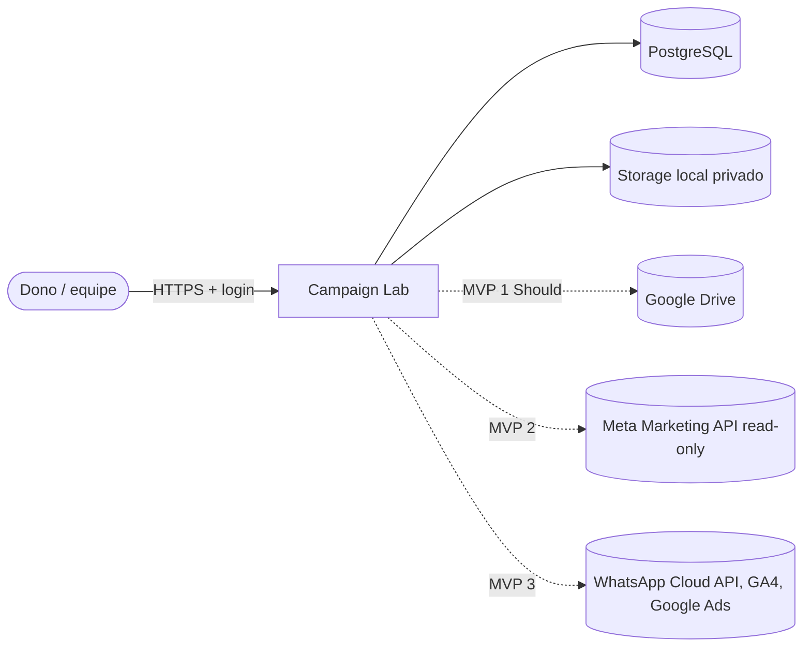

# Architecture Context

> Lido sob demanda. Fonte da verdade sobre **como** o sistema é construído.
> Regra: só registre aqui o que é verdade no código (ou foi aprovado). Decisões e o porquê → ADRs em `decisions/`.
> Detalhes completos (entidades, endpoints, métricas, integrações): `context/reference/01_ESPECIFICACAO_PARA_CLAUDE.md` §4–§11.

| Campo | Valor |
|---|---|
| Última atualização | 2026-11-21 |
| Estilo arquitetural | Monólito modular (um app Next.js com API interna) + worker de jobs; tudo em Docker Compose na VPS |
| Estado | **Implementado (MVP em andamento)** — ver progress-tracker. |

## 1. Visão de contexto (C4 nível 1)


## 2. Componentes (C4 nível 2)
| Componente | Responsabilidade | Tecnologia | Pasta |
|---|---|---|---|
| Web | Telas (pt-BR), mobile-friendly | Next.js App Router, React, Tailwind, shadcn/ui, Recharts | `src/app` |
| API interna | Rotas `/api/*` com auth + autorização por workspace/marca | Next.js Route Handlers, Zod | `src/app/api` |
| Domínio | Importador CSCAMP/1, métricas, atribuição, CRM | TypeScript puro (testável sem banco) | `src/domain` |
| Provedores | Interfaces `AdsProvider`, `AnalyticsProvider`, `AssetStorageProvider`, `LeadInboxProvider` + modo fake | TypeScript | `src/providers` |
| Dados | Schema e migrations (sem seeds DEMO: nenhum dado fictício) | Prisma + PostgreSQL | `prisma/` |
| Worker | Jobs (sync Meta, envio ao Drive) com retry/backoff — **ainda não criado** (nada assíncrono no MVP atual) | pg-boss (processo separado, como o publisher) | `src/worker` |

## 3. Stack (espelha o `publisher` do Social Media Automation — ADR-0002)
| Camada | Tecnologia | Versão | Por quê |
|---|---|---|---|
| Runtime | Node.js | >= 22.12 | igual ao publisher |
| Linguagem | TypeScript (strict) | ^5 | ADR-0002 |
| Framework | Next.js App Router + React | 16.4.6 / 19.3.0 | igual ao publisher |
| Banco de dados | PostgreSQL + Prisma (`@prisma/adapter-pg`) | Prisma ^7.10.1 | igual ao publisher; **banco próprio** |
| Auth | Better Auth — papéis OWNER/EDITOR/SALES/VIEWER | ^1.7.14 | mesmas tabelas de usuário/sessão → integração futura fácil |
| Fila de jobs | pg-boss (no próprio Postgres) — instalar quando o worker for criado | ^12.38.0 | igual ao publisher; sem Redis |
| Validação | Zod | ^4.6.7 | |
| UI | Tailwind CSS 4 (+ shadcn/ui, Recharts a confirmar na spec 02) | ^4 | |
| Testes | Vitest (+ Playwright e2e a confirmar) | ^5.0.5 | igual ao publisher |
| Hospedagem | Docker Compose na VPS + proxy HTTPS já existente (Caddy ou Traefik do publisher) | — | |

Versões conferidas no `package.json` do publisher em 2026-11-14; reconfirmar no momento do `npm install`.

## 4. Estrutura de pastas (planejada)
```
/src/app        → telas e rotas /api
/src/domain     → regras de negócio puras (importador, métricas, atribuição)
/src/providers  → adaptadores de integrações (+ fakes)
/src/worker     → jobs assíncronos
/prisma         → schema, migrations, seed DEMO
/tests          → e2e
/context        → documentação para humanos + IA
```

## 5. Fluxos principais de dados
1. TXT CSCAMP/1 → `POST /api/import/campaigns/preview` (valida, diff, duplicados) → `commit` cria só rascunhos (`ImportBatch` com hash).
2. Upload de mídia → storage local privado (sha256, metadados no banco) → depois sync para Drive (`UPLOAD_PENDING` + retry).
3. Dono vincula `PublishedAd` (ID remoto) a uma `AdVariant`; CSV do Ads Manager faz upsert por ID remoto + data (sem somar duas vezes).
4. Lead → touchpoints → qualificação → visita → proposta → job com custos → dashboard calcula CPQL, CAC e margem.
5. Resultados por anúncio (spec 02): `src/lib/ad-results-service.ts` carrega anúncios + métricas (uma fonte por dia) + leads → `src/domain/ad-results.ts` (resumo: total, 7 dias, gasto desde a última visita) → `src/domain/ad-decision.ts` (fase teste/vivo/encerrado, veredito, diagnóstico, alertas) → `src/domain/ad-today.ts` ("O que fazer hoje", placar por ângulo). Decisões do dono ficam em `AdDecision` com snapshot congelado.

## 6. Modelo de dados
Entidades da spec §5: `User`, `Workspace`, `Membership`, `Brand`, `BrandDocument`, `PersonaVersion`, `ChannelAccount`,
`CampaignPlan`, `Experiment`, `ExperimentArm`, `AdVariant`, `CreativeAsset`, `PublishedAd`, `DailyAdInsight`, `Lead`,
`LeadTouchpoint`, `Appointment`, `AdDecision` (spec 02; `PublishedAd.lifecycle` TESTING/LIVE/ENDED, metas e regras em `Brand`), `Estimate`, `Job`, `JobCost`, `SyncJob`, `AuditLog`, `ImportBatch`, `AttributionRule`.
Regras: UUID; `Decimal` para dinheiro; moeda e fuso por marca; soft-delete + audit log; multi-marca desde o dia 1.

## 7. Integrações externas
| Serviço | Para quê | Fase | Estado |
|---|---|---|---|
| Google Drive API | Guardar mídia | MVP 1 (Should) | Desconectado |
| Meta Marketing API | Sync read-only de anúncios e insights | MVP 2 | Desconectado |
| Meta Lead Ads webhooks | Leads de Instant Forms | MVP 2 opcional | Desconectado |
| WhatsApp Cloud API, Pixel/CAPI, GA4, Google Ads | Mensagens, eventos, analytics | MVP 3 | Desconectado |

Nenhuma integração é exibida como "Conectada" sem token validado.

## 8. Requisitos não-funcionais
- **Segurança:** HTTPS; RBAC por marca em toda rota; tokens OAuth criptografados só no servidor; import TXT tratado como texto (sem HTML), limite de 2 MB; upload com MIME sniffing e limite de tamanho.
- **Privacidade:** PII de lead com acesso restrito; nada de PII em UTM/Pixel/GA4.
- **Disponibilidade:** falha de API externa não bloqueia o app; relatórios mostram "última atualização".
- **Backup:** dump diário do PostgreSQL com teste de restauração.
- **Custo:** só a VPS existente no MVP 1.

## 9. Segredos e configuração
- Variáveis em `.env.example` (sem valores reais). Lista definida na spec 02.

## 10. Comandos
| Ação | Comando |
|---|---|
| Banco local | `docker compose -f compose.dev.yaml up -d` (Postgres na porta 5434) |
| Instalar | `npm install` |
| Migrations (dev) | `npm run db:migrate` |
| Rodar em dev | `npm run dev` → http://localhost:3000 (sem `.env`: usa os padrões de `src/lib/env.ts`) |
| Testes unitários | `npm test` |
| Testes de navegador | `npm run test:e2e` (build + zera só o banco `campaignlab_e2e` + Playwright) |
| Lint | `npm run lint` |
| Type check | `npx tsc --noEmit` |
| Build | `npm run build` |
| Verificação do kit | `node scripts/verify.mjs` (contexto + unit + tipos + lint) |

## 11. Ambientes e deploy
| Ambiente | URL/local | Como faz deploy |
|---|---|---|
| Dev | local (Docker Compose) | — |
| Prod | `ads.<domínio>` [NEEDS CLARIFICATION: qual domínio/subdomínio; qual proxy roda hoje na VPS (Caddy ou Traefik)] | Docker Compose na VPS (manual de deploy na spec de deploy) |

## 12. Zonas protegidas
- `prisma/migrations/**` depois de aplicadas em produção.
- `context/reference/**` (material original do dono).

## 13. Compatibilidade com o Social Media Automation (`D:\Social Media Automation\publisher`)
Sem integração agora. Para facilitar no futuro:
- Mesma stack e mesmas versões; mesmo padrão de pastas (`src/`, `prisma/`, `src/worker`).
- Mesmo modelo de identidade (Better Auth: `user`, `session`, `account`) e de workspace/membros.
- Bancos **separados** (outro database/schema e outro usuário Postgres). Integração futura será por API HTTP autenticada, nunca por acesso direto ao banco do outro app.
- Mesmo proxy/rede Docker da VPS, em subdomínio próprio.
