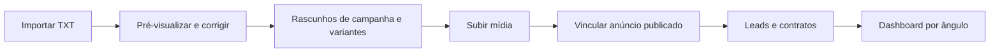

# UI Context

> Lido antes de qualquer trabalho de interface. Tokens visuais ficam em `feature-specs/01-design-system.md`.
> Referência visual: `context/reference/05_PROTOTIPO_VISUAL.html` (dados fictícios). Telas detalhadas: spec original §2.

| Campo | Valor |
|---|---|
| Plataforma | Web (Next.js), responsiva |
| Dispositivos-alvo | Desktop e celular; consultas rápidas no celular devem funcionar bem |
| Biblioteca de componentes | Tailwind CSS 4 + shadcn/ui (a confirmar na spec 01) |
| Referências visuais | `context/reference/05_PROTOTIPO_VISUAL.html` |

## 1. Princípios de UX
1. **Lucro antes de likes:** os cartões do topo mostram gasto, leads válidos, qualificados, propostas, ganhos e margem — não curtidas.
2. **Origem do dado sempre visível:** todo número tem etiqueta `Meta API`, `CSV`, `Manual`, `GA4`, `CRM` ou `DEMO`, e mostra a última atualização.
3. **Honestidade:** integração não conectada aparece como "Desconectado"; métrica sem denominador aparece `N/D`.
4. **Nada é publicado sem querer:** importar cria rascunho; ações destrutivas pedem confirmação.
5. **Troca de marca em 1 clique:** seletor de conta/marca sempre no topo.

## 2. Mapa de telas
| Tela / rota | Objetivo |
|---|---|
| `/login` | Entrar |
| `/` Dashboard | Cartões, funil, comparativo por ângulo, diagnóstico de qualidade dos dados; filtros globais |
| `/brands` | Marcas/contas do workspace; criar marca |
| `/brands/[id]/kit` | Persona e brand kit (documentos versionados) |
| `/campaigns`, `/campaigns/[id]` | Campanhas planejadas; abas Criativos, Publicações, Leads, Funil, Financeiro, Histórico |
| `/variants/[id]` | Conteúdo, mídia, publicações, métricas, comentários e versões da variante |
| `/experiments` | Laboratório A/B (rótulos `TESTANDO`, `DADOS INSUFICIENTES`, `MELHOR QUALIDADE (PROVISÓRIO)`…) |
| `/library` | Biblioteca de criativos |
| `/import` | Importar TXT: arrastar, pré-visualizar, erros por linha, importar como rascunho |
| `/published` | Anúncios publicados e vínculo com variantes |
| `/leads` | Leads & orçamentos (pipeline) |
| `/reports` | Relatórios exportáveis (CSV/JSON/TXT) |
| `/integrations` | Estado real das conexões |
| `/settings` | Usuários, papéis, preferências |

## 3. Fluxos principais

## 4. Estados obrigatórios de toda tela/componente
- **Carregando** · **Vazio** (com chamada para ação) · **Erro** (o que aconteceu + o que fazer) · **Sucesso**
- Ações destrutivas pedem confirmação; ações longas mostram progresso.

## 5. Layout e responsividade
- Sidebar no desktop; menu recolhido no celular. Breakpoints padrão do Tailwind.

## 6. Acessibilidade (meta: WCAG 2.2 AA)
- Contraste mínimo 4.5:1; operável por teclado com foco visível; labels em todos os campos; não usar só cor (rótulos de status também em texto).

## 7. Conteúdo e tom de voz
- Interface em **pt-BR** (sem i18n no MVP). Textos de anúncio exibidos como foram escritos (en-US).
- Tom direto e simples. Erros: o que aconteceu + o que fazer.

## 8. Não fazer
- Números fictícios sem `DEMO`; badge "Ativo"/"Conectado" sem dado real.
- Declarar vencedor de teste só por CTR/likes ou com amostra pequena; p-value inventado.
- Renderizar texto importado como HTML.
